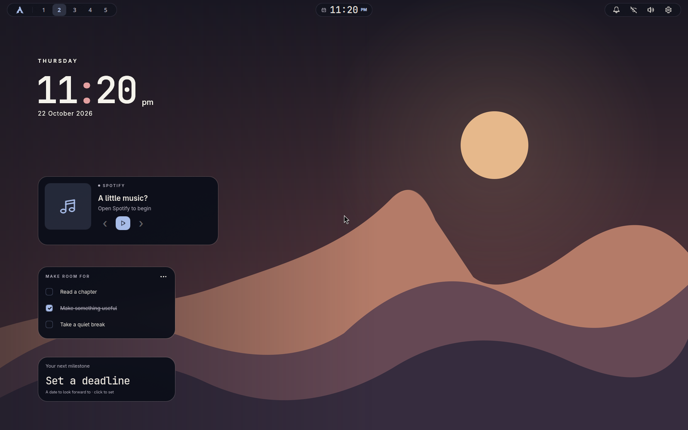
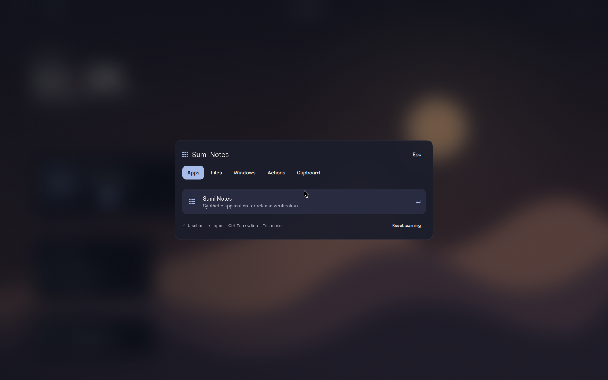
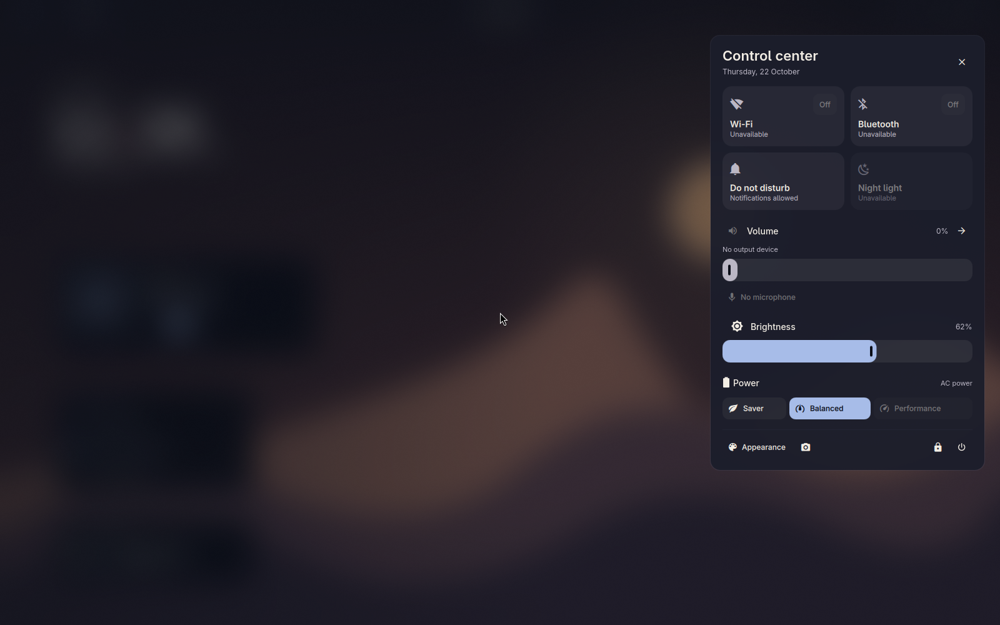

# Sumi Desktop

A glass desktop for **Arch Linux + Hyprland**, built with Quickshell. Quiet surfaces, expressive motion, and a keyboard-first command hub.



| Command hub | Quick settings |
| --- | --- |
|  |  |

These are actual nested Hyprland captures using distributable wallpapers and synthetic content. Brightness is a test fixture; physical devices were isolated. See [verification](docs/verification.md) for what was exercised.

## What you get

- A glass bar, workspace controls, system tray, and anchored panels.
- A searchable launcher with local learning, files, clipboard history, and window navigation.
- Audio, network, Bluetooth, brightness, night-light, and power controls that handle missing hardware.
- Notification history, Do Not Disturb, MPRIS media controls, and a focus timer.
- Three original landscapes—Ember, Tide, Ink—with 25 color presets and matching widget layouts.
- Desktop clock, optional Spotify widget, priorities, deadline, and a widget editor.
- Screenshots, annotation, recording, lock, idle handling, and adaptive or reduced motion.
- An installer with explicit collision consent, verified backups, updates, rollback, and ownership-aware removal.

Thursday and Codex integrations are excluded. MIT-licensed source and original wallpapers; the Arch mark retains its [separate license](assets/README.md).

## Before you install

Use an **already installed Arch Linux x86_64 system** with working networking, graphics drivers, a normal user account, and sudo access. Sumi uses Hyprland's current Lua configuration (0.55+) and Quickshell 0.3+ from official Arch repositories.

The installer does not partition disks, install GPU drivers, or replace a display manager. It shows its package operation, including a full Arch upgrade, before running it. Keep a text console available for recovery.

Install the small bootstrap tools if needed:

```sh
sudo pacman -Syu --needed git python sudo
```

## Install

```sh
git clone https://github.com/9MidhunPM/sumi-desktop.git
cd sumi-desktop
./install.sh --dry-run
./install.sh
```

Run setup as your normal user. The dry run changes no configuration, packages, services, or private state. When an existing destination is found, you must type **Back up and use Sumi** before replacement; any other answer exits unchanged. Pacman asks for confirmation separately.

Log out, choose **Hyprland** in your login screen, and sign in. From a text console, run `Hyprland`. Press **Super+Space** for the command hub, **Super+Enter** for a terminal, **Super+/** for shortcuts, and **Super+L** to lock.

The [first-run guide](docs/quickstart.md) walks through the whole process. If your shell cannot find `desktopctl`, use `"$HOME/.local/bin/desktopctl"`.

## Make it yours

Use Appearance to change wallpapers, palettes, and motion. Add personal compositor settings to `$XDG_CONFIG_HOME/hypr/local.lua` (normally `~/.config/hypr/local.lua`); updates retain this file and other unmanaged Hyprland files. Managed defaults may be replaced after a backup.

The installed runtime is copied into `$XDG_DATA_HOME/sumi/runtime` (normally `~/.local/share/sumi/runtime`), independent of the checkout. Notification history, launcher learning, and imported wallpapers stay in private XDG directories.

Read [customization and shortcuts](docs/customization.md) for keyboard layout, monitors, widgets, application defaults, and themes. The desktop Spotify widget is optional; Spotify is not installed by Sumi. The bar's media controls work with general MPRIS players.

## Update, recover, or remove

```sh
# From this source checkout:
git pull --ff-only
./install.sh --update

# From your installed desktop or text console:
desktopctl doctor --check
desktopctl rollback --dry-run
desktopctl uninstall --dry-run
```

Remove `--dry-run` when you want rollback or uninstall to run. Updates retain a rollback snapshot. Uninstall preserves user data, backups, and subsequently edited artifacts; changed directories are preserved as a whole. Packages and system networking services remain installed.

[Recovery and troubleshooting](docs/recovery.md) covers interrupted setup, previous-desktop recovery, and safe removal. Previous-desktop recovery is offered only when a usable backup exists.

## Verification and support

[Release verification](docs/verification.md) separates Python tests, offscreen QML tests, fresh Arch installation, and native compositor checks. Physical hardware operations and a display-manager boot are separate from isolated GUI tests; this first release does not claim a full hardware certification matrix.

See [the changelog](CHANGELOG.md), [contributing](CONTRIBUTING.md), and [security reporting](SECURITY.md). Report reproducible problems through the repository's issue forms, without attaching private state or backups.
